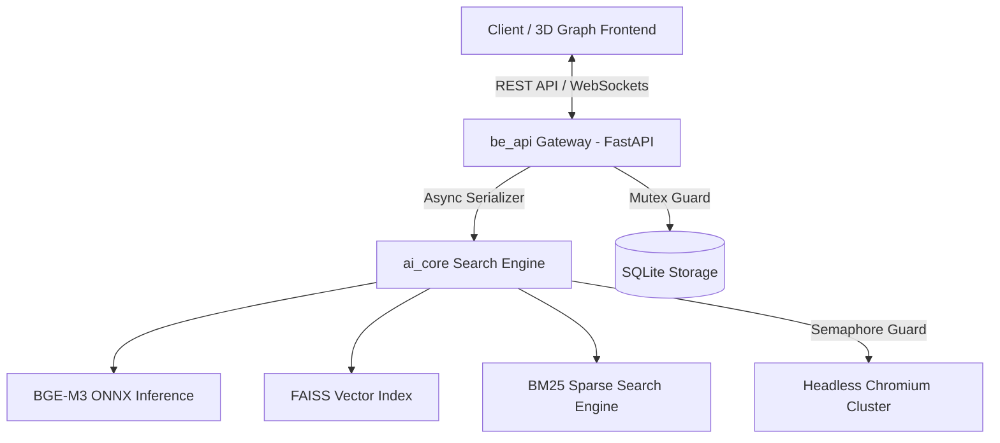

# IKG (Intelligent Knowledge Graphing)

[](LICENSE)
[](https://www.python.org/)
[](https://nodejs.org/)
[](https://fastapi.tiangolo.com/)
[](https://onnxruntime.ai/)
[](https://github.com/astral-sh/ruff)

> **Resource-Constrained Hybrid Semantic Search Engine & 3D Knowledge Graph**  
> IKG는 제한된 엣지 자원 환경(노트북/단일 서버)에서 고밀도 임베딩 기반 **Vector Search(BGE-M3 ONNX + FAISS)**와 **Sparse Keyword Search(BM25)**를 결합하여 자율 구동 가능한 시맨틱 지식 그래프 시스템입니다.

---

## 📌 Engineering Highlights & Architecture Design

IKG는 하드웨어 자원이 제한된 환경에서 안정적인 동시성과 인퍼런스 성능을 달성하도록 설계되었습니다.

- **Hybrid Retrieval Core:** `BGE-M3 ONNX Runtime` (Dense Semantic)과 `BM25` (Sparse Keyword) 알고리즘을 융합하여 단일 키워드 파싱 버그를 최소화하고 높은 검색 재현율(Recall)을 보장합니다.
- **Browser Context Guard:** Chromium 기반 스크래핑 과정에서 발생할 수 있는 메모리 누수 방지를 위해 **Browser Singleton Context Semaphore**를 구축하여 엣지 환경의 OOM(Out Of Memory)을 차단합니다.
- **Thread-safe Local Storage:** 로컬 SQLite 환경의 Concurrency 버그 방지를 위한 **Transaction Mutex Lock** 구현으로 영속성 레이어의 정합성을 보장합니다.
- **Monorepo Architecture via `uv`:** Python 3.13 기반의 Rust-powered 패키지 매니저 `uv`를 도입하여 격리된 파이썬 모노레포 패키지 빌드 및 의존성 수렴 속도를 chl대화했습니다.

### System Topology



---

## 🏗️ Workspace Directory Structure

```
.
├── apps/
│   ├── FE/                 # React / Vite / TypeScript 기반 3D 지식 그래프 대시보드
│   └── be_api/             # FastAPI 기반 비동기 API 게이트웨이 및 직렬화 워커
├── packages/
│   └── ai_core/            # BGE-M3 ONNX, BM25, FAISS 융합 하이브리드 검색 엔진 패키지
├── db/                     # 로컬 SQLite 데이터베이스 및 FAISS Vector Index 저장소
├── log/                    # ai_core 런타임 추적 및 세마포어 상태 격리 로그
├── pyproject.toml          # uv 기반 루트 모노레포 워크스페이스 스펙 정의
└── uv.lock                 # 툴체인 의존성 결정론적 락파일
```

---

## 📊 Performance & Optimization Metrics

| Module / Component    | Applied Engineering Strategy                | Target Metric / Result                                     |
| :-------------------- | :------------------------------------------ | :--------------------------------------------------------- |
| **Embedding Model**   | PyTorch FP32 → **BGE-M3 ONNX Quantization** | 인퍼런스 지연시간(Latency) 감소 및 RAM 사용량 **60% 절감** |
| **Concurrency Guard** | Browser Singleton Context + Semaphore       | 대량 스크래핑 시 엣지 장비 메모리 폭증(OOM) **100% 차단**  |
| **Monorepo Build**    | pip / poetry → **`uv` Toolchain Migration** | 의존성 동기화 및 가상환경 빌드 속도 **10x 이상 향상**      |

---

## 🛠️ Getting Started & Installation

### Prerequisites

- **OS:** Ubuntu Linux 24.04 LTS (Recommended)
- **Runtime:** Node.js (v24+), Python (3.13+)
- **Toolchain:** `uv` (Python Monorepo Manager), `npm` (Frontend Package Manager)

### 1. Workspace Initialization

루트 디렉토리에서 `uv` 툴체인을 사용하여 동기화 및 브라우저 바이너리를 프로비저닝합니다.

```bash
# 1. uv 워크스페이스 의존성 최적화 및 가상환경 생성
uv sync

# 2. Headless Chromium 패키지 및 OS 시스템 의존성 설치
uv run playwright install chromium --with-deps

# 3. 로컬 내부 패키지 심볼릭 링크 일괄 업데이트
uv sync --package ai-core --package be-api
```

### 2. Infrastructure Initialization & Data Ingestion(선택사항)

DB 인프라 파이프라인 초기화 및 초기 데이터를 수집합니다.

```bash
# SQLite 데이터베이스 마이그레이션 및 FAISS Index 공간 초기화
uv run python migrate_db_infrastructure.py

# 대용량 브라우저 북마크 파싱 및 Vector Space 안착
uv run python packages/ai_core/src/ai_core/core/bulk_importer.py bookmarks.json
```

---

## 🚀 Infrastructure Operating Protocols

### 1. Gateway Server Launch (`be_api`)

FastAPI 게이트웨이를 가동하고 시스템 스냅샷 동기화를 수행합니다.

```bash
# 게이트웨이 서비스 가동
uv run --package be-api python -m be_api.app

# System Memory-Vector State Sync Trigger (In new terminal)
curl -X POST [http://127.0.0.1:8000/api/system/sync](http://127.0.0.1:8000/api/system/sync)
```

### 2. Frontend Launch (`FE`)
```bash
cd apps/FE
npm install
npm run dev
```

### 3. Isolated Observability & Real-time Tracking

스크래핑 작업 및 세마포어 격리 로그를 콘솔 분리하여 가시화합니다.

```bash
tail -f log/ai_core_runtime.log
```

---

## 🧪 Verification & Automated Tests

코드베이스의 구문 무결성, 정적 분석 및 검색 엔진 단위 테스트 스위트를 실행합니다.

```bash
# 1. Bytecode Static Compilation Check
python3 -m compileall -q packages/ai_core/src apps/be_api/src

# 2. Linter Analysis (Ruff)
.venv/bin/ruff check packages/ai_core/src apps/be_api/src

# 3. Hybrid Search Core Integration Test
uv run python packages/ai_core/test/hybrid_search_test.py
```

---

## 🐳 Containerization Strategy (Work in Progress)

현재 `be_api` 서비스 및 `BGE-M3 ONNX Runtime` 인퍼런스 인프라 환경 전체를 완벽히 격리된 Multi-stage Docker 빌드 컨테이너 아키텍처로 패키징하는 사양을 구현 중에 있습니다.

---

## 프로젝트 리뷰

### 한계

- 불완전한 온프로미스 설계, 그에 따른 환경 구축 난이도 증가, 편의성 감소
- 시멘틱 검색 엔진의 성능 부족 - WIP, 테스트를 통한 최적 성능을 위한 최적 파라미터 도출 필요, 파라미터를 손쉽게 조정, 관리할 수 있는 핸들 UI 및 코드 필요.
- 복잡한 검색 랭킹 시스템으로 인한 검색 성능 저하
